# FUZZTeam_fish - 钓鱼演练系统

对目标单位员工进行安全意识测试的钓鱼演练平台，支持管理目标、生成绑定目标的 EXE 或 LNK 压缩包、接收回传数据。仅用于获得授权的钓鱼演练与安全意识测试。

## 功能特性

- 目标管理：单个添加、批量导入（TXT/CSV/XLSX）、分页与服务端搜索
- EXE 生成：基础 EXE + 目标配置 footer 注入，每个目标独立回传
- LNK 压缩包：伪装成文档的快捷方式投递，六种免杀方式可多选组合
- 数据采集：主机信息、屏幕截图、桌面/磁盘目录信息
- 数据管理：采集记录查看、截图预览、导入导出与清理
- 部署方式：Windows 本地运行或 Linux + Docker 一键部署

## 快速开始 (本地运行)

```bash
# 安装依赖
pip install -r requirements.txt

# 启动服务 (Windows 会自动构建基础 EXE)
python run.py --host 0.0.0.0

# 浏览器访问输出的管理面板地址，默认账号密码:
# 用户名: fish
# 密码: fishfish@123
```

## Docker 部署 (Linux)

```bash
# 克隆仓库
git clone https://github.com/Herbert-555/FUZZTeam_fish.git
cd FUZZTeam_fish

# 部署
bash install_fish.sh

# 使用国内 pip 镜像加速
PIP_INDEX_URL=https://pypi.tuna.tsinghua.edu.cn/simple bash install_fish.sh

# 自定义端口
FUZZTEAM_FISH_MANAGE_PORT=8000 FUZZTEAM_FISH_LISTEN_PORT=9000 bash install_fish.sh

# 查看管理面板地址
docker logs fuzzteam-fish
```

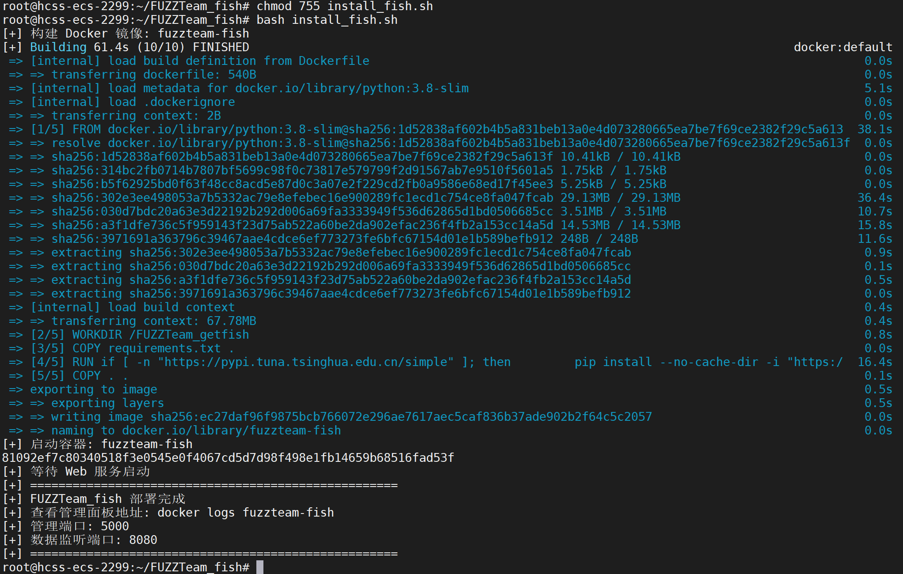

执行`docker logs fuzzteam-fish`获取访问地址

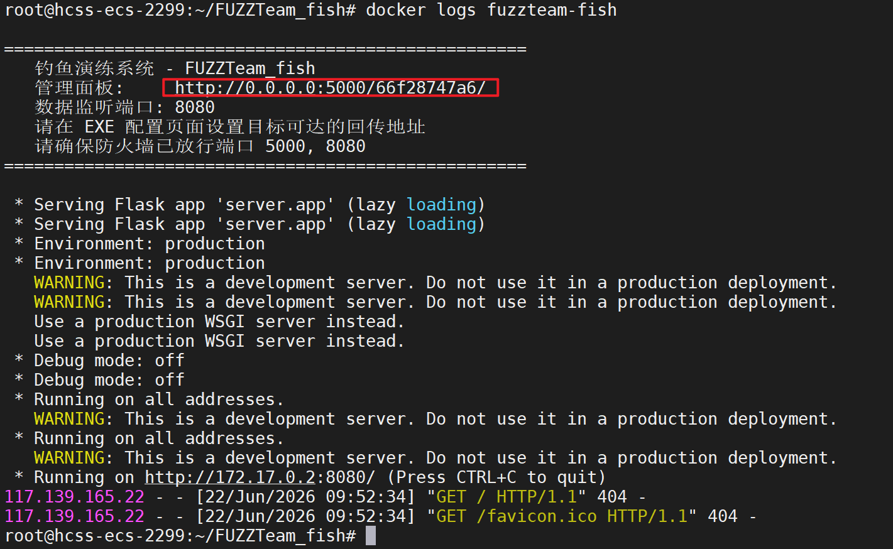

访问vps的`http://<ip>:5000/66f28747a6/`，就能访问管理端


### 环境变量

| 变量                        | 默认值          | 说明             |
| --------------------------- | --------------- | ---------------- |
| `FUZZTEAM_FISH_CONTAINER`   | `fuzzteam-fish` | 容器名称         |
| `FUZZTEAM_FISH_IMAGE`       | `fuzzteam-fish` | 镜像名称         |
| `FUZZTEAM_FISH_MANAGE_PORT` | `5000`          | 管理面板端口     |
| `FUZZTEAM_FISH_LISTEN_PORT` | `8080`          | EXE 回传数据端口 |
| `FUZZTEAM_FISH_DATA`        | `./data`        | 数据库持久化目录 |
| `FUZZTEAM_FISH_UPLOADS`     | `./uploads`     | 截图上传目录     |
| `FUZZTEAM_FISH_OUTPUT`      | `./output`      | EXE 输出目录     |
| `PIP_INDEX_URL`             | 空              | pip 镜像源地址   |


## 系统使用

### 使用流程

1. 登录管理面板
2. 在「目标管理」中添加/批量导入目标
3. 在「EXE 配置」中设置图标、文件名模板、行为选项；如需 LNK 投递，同时配置伪装后缀与免杀方式
4. 在「EXE / LNK 生成」中生成目标 EXE 或 LNK 压缩包
5. 将生成的 EXE/ZIP 分发给目标（通过邮件、U盘等）
6. 目标运行后，在「采集数据」中查看回传的主机信息、截图、目录结构

使用`fish/fishfish@123`登录系统，到 **exe配置** 界面配置VPS的IP

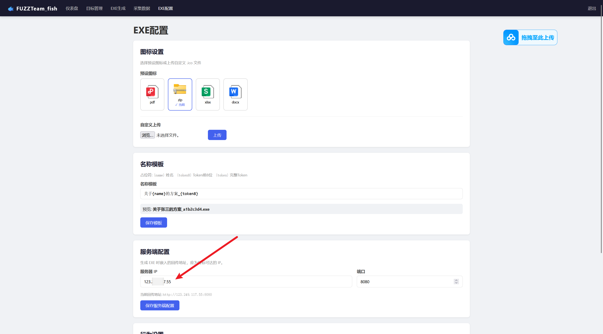

目标管理处添加目标

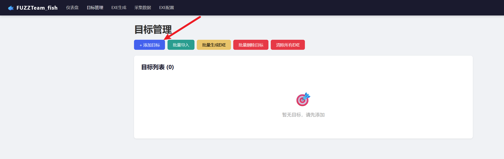

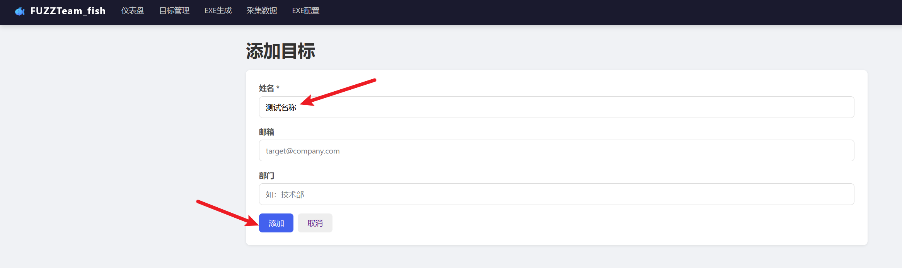

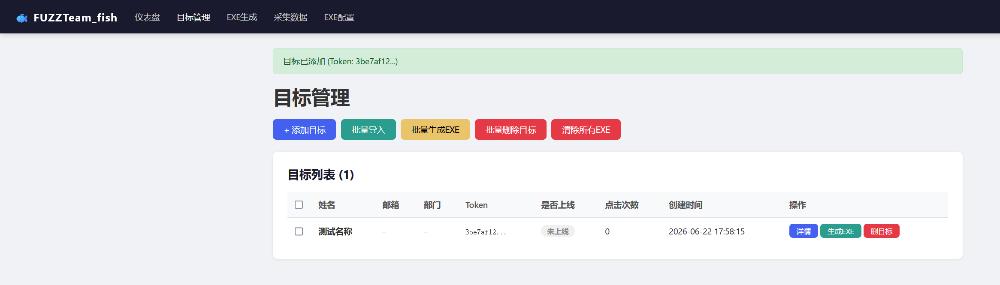

点击生成exe

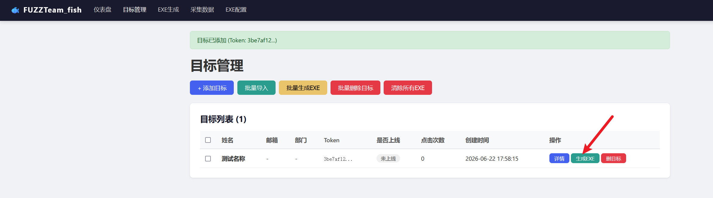

生成后下载

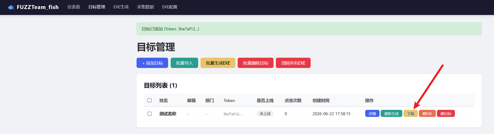

下载完成后放到目标机器进行执行

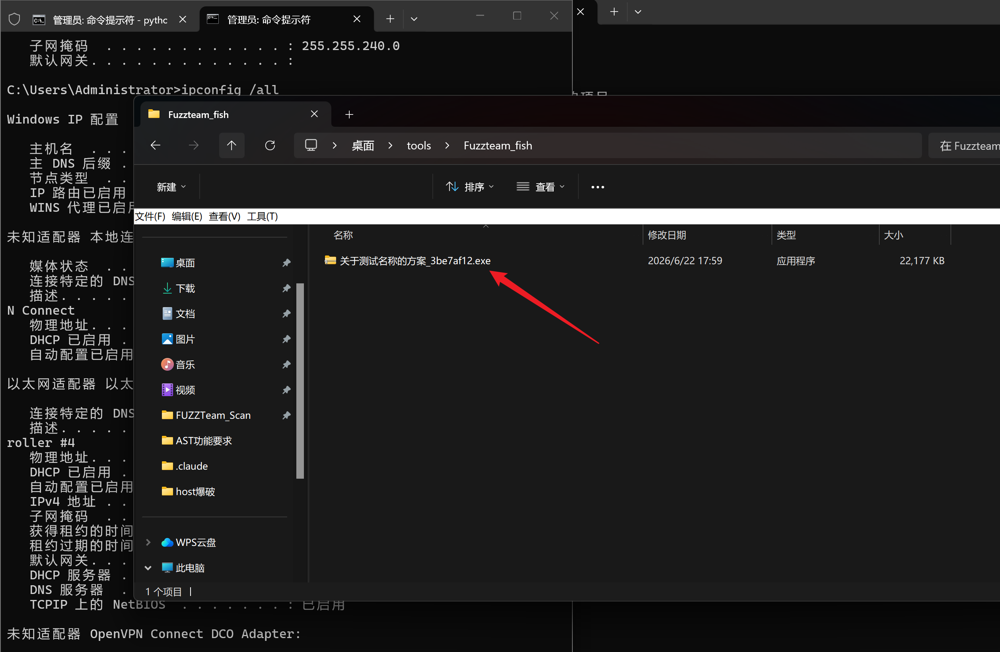

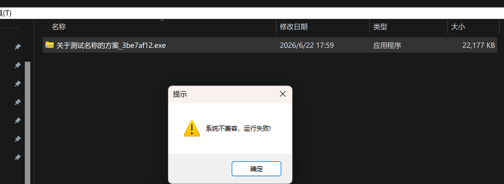

如果目标出网就可以获取回传信息

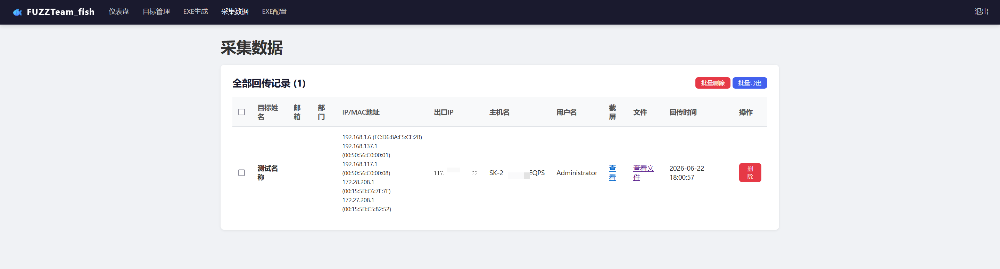

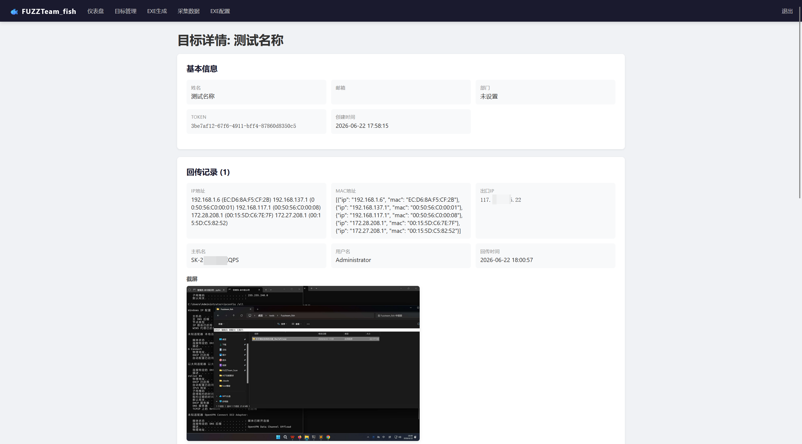

自动获取目标桌面、c盘、d盘文件名称大小信息

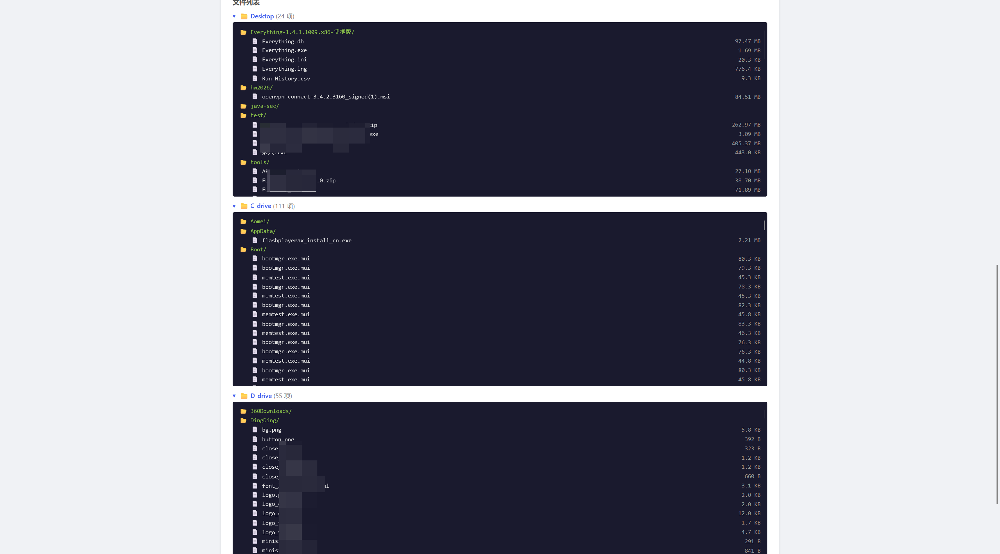


## LNK 压缩包投递

除 EXE 外，系统可为每个目标生成 LNK 压缩包：包内只显示一个伪装成文档的快捷方式（`文件名.<后缀>.lnk`，Windows 默认隐藏 `.lnk` 后缀），实际的采集 EXE 与脚本位于隐藏目录。

使用方式：

1. 在「EXE 配置」→「LNK 压缩包」中选择伪装后缀并勾选免杀方式（可多选，默认不启用）
2. 在「目标管理」或「EXE / LNK 生成」中点击「生成 LNK」，生成后下载 ZIP
3. 通过邮件、网盘或即时通讯投递，目标解压后双击伪装的快捷方式

免杀方式：

| 选项 | 说明 |
| --- | --- |
| conhost 无窗口执行 | 通过 `conhost.exe --headless` 读取命令文件，不弹出控制台（Windows 10 1809+） |
| Explorer → VBS → BAT 隐藏链 | LNK 启动 VBS，VBS 隐藏运行 BAT 拉起载荷，增加静态分析层级 |
| 字符串拆分 + 干扰码 | BAT 内拆分拼接载荷名并插入延时干扰命令，自动启用 VBS 链 |
| 打开诱饵文档 | 载荷启动后打开同后缀诱饵文档，自动启用 VBS 链 |
| 参数空白填充 | LNK 参数前填充空白，属性面板中不易直接看到真实参数 |
| 伪装 `__MACOSX` 目录 | 将载荷目录嵌套为 `__MACOSX` 层级并隐藏，模拟压缩包元数据目录 |

说明：

- 默认由系统自带的 `ftp.exe -s:...` 启动命令文件；启用 conhost 后改为 `conhost.exe --headless` 无窗口读取命令文件
- 链式命令使用相对路径，依赖资源管理器双击快捷方式时将工作目录设为快捷方式所在目录；通过脚本或命令行直接调用时行为可能不同
- 压缩包内载荷与脚本设置了隐藏属性；诱饵文档为动态生成的最小 PDF/DOCX/XLSX/ZIP
- 需要 `pylnk3` 依赖（已包含在 `requirements.txt`）

## 架构

```
run.py                    # 启动入口
server/                   # 服务端
├── app.py                # Flask 应用工厂
├── models.py             # SQLite 数据库模型
├── routes.py             # Web 路由 + API 端点
├── exe_builder.py        # EXE 生成 (footer 注入 / PyInstaller)
├── lnk_builder.py        # LNK 压缩包生成与免杀组合
├── config_manager.py     # EXE 配置管理
├── icon_extractor.py     # 内置图标生成
├── pe_icon.py            # PE 图标注入
├── static/               # 样式、脚本、图标
└── templates/            # Jinja2 模板
client/
└── collector.py          # 客户端采集脚本 (被打包进 EXE)
```

## 技术要点

- **跨平台 EXE 生成**：Windows 上通过 PyInstaller 构建基础 EXE，Linux 上通过复制 + footer 注入生成目标 EXE，无需 Wine
- **配置加密**：EXE footer 中的配置使用 XOR 加密（密钥 `fishfish@aes`）
- **LNK 生成**：`pylnk3` 构造快捷方式，ZIP 内通过 DOS 属性隐藏载荷目录，支持 ftp/conhost/VBS 多种启动链
- **客户端功能**：采集主机信息、截屏、目录扫描、弹窗提示、自毁删除
- **默认账号**：`fish` / `fishfish@123`
